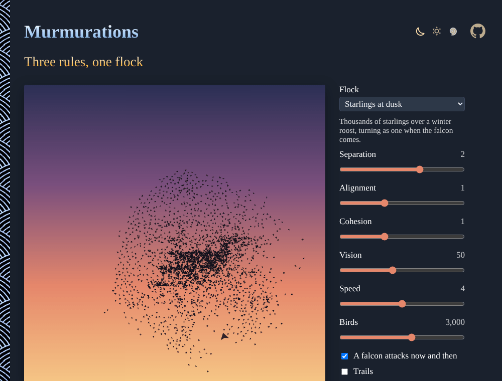

# Murmurations

Thousands of birds follow three simple rules (keep apart, fly the same way, stay together) and turn as one, like starlings at dusk. Craig Reynolds' boids in the browser, with a falcon under your pointer. No sign-up, no libraries.

**[▶ Watch the flock](https://evoluteur.github.io/murmurations/)**

## Features

| Control | What it does |
| ------- | ------------ |
| **Flock** | Starlings at dusk, School of fish, Midge swarm, or Fireflies. |
| **Separation** | How strongly each bird keeps its distance. |
| **Alignment** | How strongly it flies the way its neighbors fly. |
| **Cohesion** | How strongly it moves toward the middle of its neighbors. |
| **Vision** | How far it sees its neighbors. |
| **Speed** | How fast the birds fly. |
| **Birds** | From 100 to 5,000. |
| **A falcon attacks now and then** | A falcon crosses the sky toward the flock every so often. |
| **Trails** | Leave fading trails behind the birds. |
| **Download PNG** | The picture. |

Move the pointer over the sky: it is a falcon, and the flock flees. The address of the page keeps the settings, to share them.

## How it is built

Each bird has a position and a velocity. At every frame it looks at the birds within its vision (found quickly with a grid of buckets) and adds up three steering forces:

- **separation**: away from the birds that are too close,
- **alignment**: toward their average velocity,
- **cohesion**: toward their average position,

plus a soft turn at the edges of the sky, a gentle pull back over the roost, a little randomness, and a strong push away from the falcon. The speed is kept between a minimum and a maximum.

Plain HTML, CSS and JavaScript, with no dependencies and no build step:

| File | Content |
| ---- | ------- |
| [index.html](index.html) | the page and its controls |
| [js/boids.js](js/boids.js) | the birds, the falcon and the drawing |
| [css/boids.css](css/boids.css) | the styles of the page |
| [css/themes](css/themes) | the three color themes |

To run it locally, just open `index.html` in a browser. The three color themes (dark, light and blue) are shared with my other projects (copied from [omg-themes](https://github.com/evoluteur/omg-themes)).

## A little history

Craig Reynolds, *Flocks, Herds, and Schools: A Distributed Behavioral Model* (SIGGRAPH, 1987). M. Ballerini et al., *Interaction ruling animal collective behavior depends on topological rather than metric distance* (PNAS, 2008), the 3D study of starlings over Rome.

## Related projects

- [Slime Mold](https://evoluteur.github.io/slime-mold/) ([code](https://github.com/evoluteur/slime-mold))
- [Flow Fields](https://evoluteur.github.io/flow-fields/) ([code](https://github.com/evoluteur/flow-fields))
- [Game of Life](https://evoluteur.github.io/game-of-life/) ([code](https://github.com/evoluteur/game-of-life))

For more patterns grown from a few rules, see [Generative Art](https://evoluteur.github.io/generative-art.html).

## License

Murmurations is open source under the [MIT license](LICENSE).

Had fun with the app? [Buy me a coffee by becoming a sponsor](https://github.com/sponsors/evoluteur).

(c) 2026 [Olivier Giulieri](https://evoluteur.github.io/)
